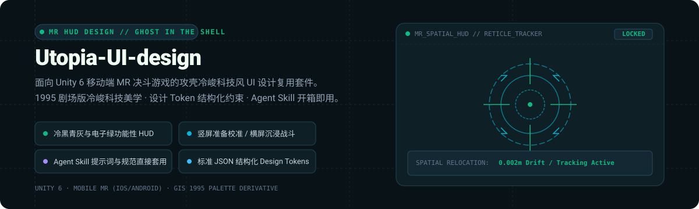
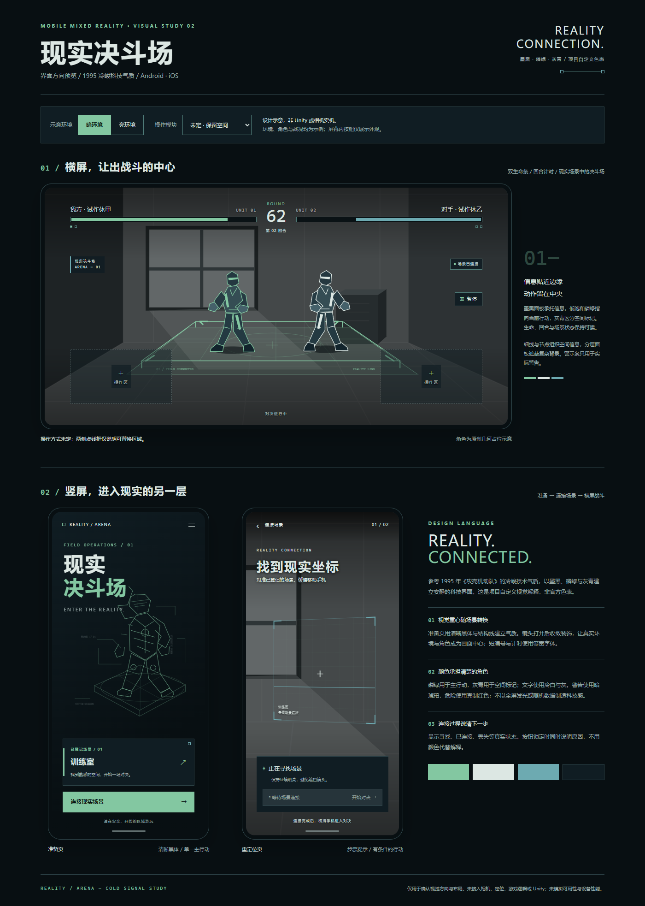

# Utopia-UI-design

  

  <a href="#视觉设计语言"><strong>设计语言</strong></a> ·
  <a href="#决斗模板交互模态"><strong>交互模态</strong></a> ·
  <a href="#资源与导航索引"><strong>资源索引</strong></a> ·
  <a href="#本地预览"><strong>本地预览</strong></a> ·
  <a href="#当前阶段与设计边界"><strong>设计边界</strong></a>

---

Utopia-UI-design 是一个面向 Unity 6、Android 与 iOS 移动端混合现实（MR）决斗游戏的专业 UI 界面设计复用套件。

项目将沉浸式空间界面设计规范、结构化设计变量（Design Tokens）与 AI 协同提示词打包封装为开箱即用的 Agent Skill，便于开发者与 AI Agent 快速搭建统一风格的科幻 MR 游戏界面。

---

## 视觉设计语言

套件以《攻壳机动队》（Ghost in the Shell 1995 剧场版）的冷峻科技气质为美学起点：
- **配色系统**：冷黑青灰作为主环境底色，高对比电子绿承担关键状态与生命值强调，冷青色负责坐标刻度与信息流导引；
- **组件风格**：追求功能性极简 HUD，包含精密机械结构分割线、雷达扫描环线、轻量准心与数据遥测指示；
- **设计说明**：色彩基准由项目设计团队独立提炼而成，非官方授权商业规范；原黑黄高对比赛事海报仅作为空间构图的辅助灵感参考。

---

## 决斗模板交互模态

模板针对移动端 MR 特征设计了双模态空间布局：
- **竖屏模态（准备与空间重定位）**：用于战前卡组配置、房间等待、以及利用移动设备摄像头进行真实物理空间平面扫描与空间锚点（Spatial Anchor）校准；
- **横屏模态（沉浸决斗对战）**：双手持握设备进入全景空间视角，两侧布局轻量半透明手势/触控技能槽，中央保持宽阔通透的 MR 混合现实观察窗；
- **组件可插拔性**：在移植至已有 Unity 工程时，可根据实际玩法操作自由裁撤或替换子模块。

---

## 资源与导航索引

- [使用说明指南 (START-HERE.md)](START-HERE.md)：快速接入与 Unity 引入指引
- [Agent Skill 规范目录 (skills/utopia-mr-ui/SKILL.md)](skills/utopia-mr-ui/SKILL.md)：供 AI 自动化调用的完整 Skill（使用时直接复制整个 `utopia-mr-ui` 目录）
- [AI 协同提示词模版 (prompts/unity-ui-agent.md)](prompts/unity-ui-agent.md)：驱动 Agent 遵循本套设计规范的 System Prompt
- [设计变量清单 (skills/utopia-mr-ui/assets/design-tokens.json)](skills/utopia-mr-ui/assets/design-tokens.json)：标准 JSON 格式的颜色、字号与圆角 Token
- [完整离线复用包 (dist/utopia-mr-ui-kit.zip)](dist/utopia-mr-ui-kit.zip)：预打包的设计产物压缩包
- [设计验证与规范走查记录 (docs/validation.md)](docs/validation.md)

---

## 本地预览

将仓库克隆到本地后，直接用浏览器打开 [交互式界面预览 (docs/design-preview.html)](docs/design-preview.html)，可实时切换明暗光影示意环境及不同操作模块候选状态（在 GitHub 网页端浏览该文件时仅展示 HTML 源码）。

  

---

## 当前阶段与设计边界

1. **规范与预览性质**：当前交付产物为视觉设计系统、结构化 Token 与交互原型，尚未接入底层 ARFoundation 相机透视流、空间重定位算法或真实对战游戏状态机；
2. **真机适配待验证**：尚未在 Unity Editor 内部组件树与 iPhone / Android 实体真机上完成全分辨率像素级烘焙验收；
3. **资源范围清晰**：参考资料主要用于确立视觉基线，不代表已产出全套现成的 Unity UGUI / UI Toolkit Prefab 实体预制体。
